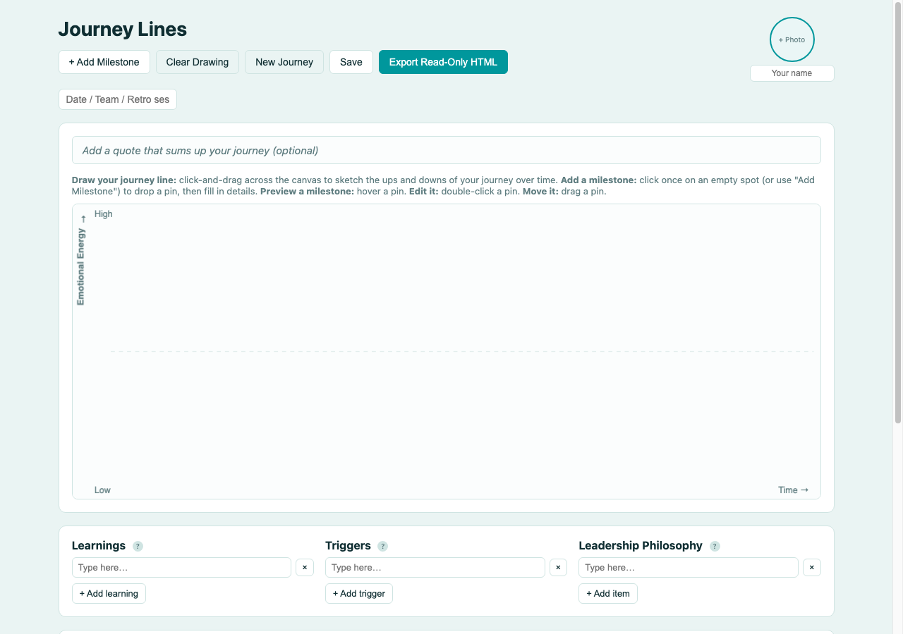

# Journey Lines

A single-file web app for running the "Journey Line" team-building and retrospective exercise: each person sketches their emotional ups and downs over time, pins milestones along the way, and captures what they learned, what triggered them, and how their leadership philosophy evolved.

Everything runs entirely in the browser. There's no build step, no server, and no data leaves the page — your work only exists on your machine unless you choose to save or export it.

## Features

- Freehand canvas to draw your emotional energy over time (high/low, left to right)
- Click to drop milestone pins on the line, with a title, date, photo, and description
- Hover a pin for a quick preview, double-click to edit it, drag to move it
- A personal photo and name shown top-right of the editor
- Lists for **Learnings**, **Triggers**, and **Leadership Philosophy**, each with a tooltip explaining what to capture there
- An optional quote to sum up your journey
- Save your work locally, or start a new journey from scratch
- Export a read-only, self-contained HTML snapshot you can share with others

## Getting started

1. Download [`journey-lines.html`](journey-lines.html)
2. Open it in any modern browser (double-click the file, or `File > Open`)
3. Draw your journey line on the canvas, then click to add milestones
4. Fill in your name, photo, date/team, and the Learnings / Triggers / Leadership Philosophy lists
5. Use **Save** to keep your progress in the browser, or **Export Read-Only HTML** to generate a shareable snapshot (downloaded as `my-journey-line-[name].html`)

No installation, accounts, or internet connection required.

## License

Licensed under [CC BY-NC 4.0](https://creativecommons.org/licenses/by-nc/4.0/) — see [LICENSE](LICENSE). You're free to share and adapt this for non-commercial use, with attribution.

Made by Marcello Majonchi.
